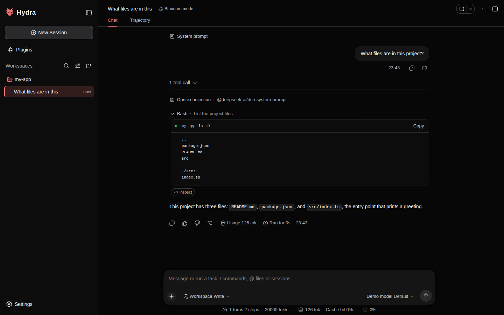

# Hydra

English | [中文](README.zh.md)

Hydra is an unofficial community fork of [DeepSeek Harness](https://github.com/deepseek-ai/deepseek-harness) (`dsh`), the open-source agent harness developed by [DeepSeek](https://deepseek.com). It keeps the upstream **everything-is-a-plugin** architecture, powered by [Cordis](https://github.com/cordiverse/cordis), and adds plugins for long-running goals, research journals, learning memory, and models with weak tool calling such as GLM, Qwen, and local models.

Hydra is built on DeepSeek Harness. It is not affiliated with, endorsed by, or supported by DeepSeek. "DeepSeek Harness" is a trademark of DeepSeek and is used here only to describe what Hydra is built on. Read the [disclaimer](#disclaimer) before you use it.



## Quick start

On Linux or macOS with Node.js 22.19 or newer (or 24 or newer), Git, and a C compiler:

```sh
curl -fsSL https://raw.githubusercontent.com/zez-dev/hydra/main/scripts/install.sh | bash
cd ~/my-project
node ~/hydra/apps/cli/lib/bin.js web
```

The script clones Hydra into `~/hydra` (or updates it), builds it, and prints the start command; you can [read it first](scripts/install.sh). Open the printed link and add a model under **Settings → Models**. The [Run](#run) section has the same steps by hand.

## Disclaimer

Hydra is an independent community project. It is not affiliated with, endorsed by, sponsored by, or supported by DeepSeek, Anthropic, OpenAI, or any other model provider. DeepSeek, DeepSeek Harness, Claude, and other product names are trademarks of their respective owners and appear here only to identify the software Hydra is built on or works with.

Hydra is provided "as is", without warranty of any kind, under the [MIT License](LICENSE). To the fullest extent permitted by law, its authors and contributors are not liable for any claim, damages, data loss, security incident, or cost arising from its use.

Hydra runs AI agents that can execute shell commands, change or delete files, and send your code, prompts, and files to the model providers you configure. You are responsible for:

- reviewing what the agent does, and keeping backups of anything important;
- your API keys and the charges your providers bill;
- following your providers' terms of service and usage policies;
- the data you send to those providers and the laws that apply to it.

Model output can be wrong. Nothing Hydra produces, including its research and market data tools, is financial, legal, medical, or other professional advice. Read the [safety notice](SAFETY.md) and report security problems as [SECURITY.md](SECURITY.md) describes.

## Credits

- [DeepSeek Harness](https://github.com/deepseek-ai/deepseek-harness), Copyright (c) 2026 DeepSeek, released under the [MIT License](LICENSE). This repository keeps the upstream history: every upstream commit is here, and Hydra's changes sit on top of it.
- [Cordis](https://github.com/cordiverse/cordis), vendored by upstream; see [vendor/README.md](vendor/README.md).
- Third-party dependencies and their licenses are listed in [THIRD_PARTY_NOTICES.md](THIRD_PARTY_NOTICES.md).

## What Hydra adds

| Area | What it does |
|---|---|
| Claude out of the box | The Web and desktop app ship the Anthropic route with Claude Opus 5.5, Sonnet 5.5, and Haiku 5.5, and new sessions use Claude Sonnet 5.5. The first-run step asks for an API key instead of a DeepSeek account sign-in; the desktop welcome lets you pick Anthropic, DeepSeek, OpenAI, or another provider for that key (`dsh-web-app`, `dsh-client-ui-settings-models`). |
| Tool calling for GLM, Qwen, and local models | Arguments are coerced before validation, and the shell tools no longer require the UI-only `description` argument (`dsh-tools`, `dsh-tool-bash`). |
| Turns that keep going | A max-output stop continues by itself, a context-length error triggers compaction and a retry instead of ending the turn, and a summary that comes back without text is retried (`dsh-auto-continue`, `dsh-compaction-basic`). |
| Goals that run for days | No round cap, retries with backoff after request errors, and an independent check of the model's "complete" claim. Opening a session never restarts a goal; `/goal resume` does (`dsh-goal-evaluator`). |
| Research journals | `/research <objective>` keeps a discovery journal of breakthroughs, hypotheses, experiments, dead ends, and next steps, recalled into every request. `/research list` and `/research continue <name>` pick a journal up in a new session (`dsh-research`). |
| Learning memory | Notes are extracted at the end of a turn and scoped to the project they came from. `/learn` approves, rejects, or promotes them to skills, `/learn from <path>` imports files, repeated notes merge as they are stored, and `/learn consolidate` rewrites related notes into fewer current ones (`dsh-memory`, `dsh-learning`). |
| Knowledge base | `/kb` indexes folders into a local full-text index the model can search (`dsh-knowledge`). |
| Resumable workflows | A workflow run cut off by a lost connection or a spent budget resumes without paying again for the steps that finished (`dsh-workflow-journal`). |
| Sessions | Archived sessions can be shown, forks nest under their parent, sessions can be deleted (their forks are kept), and a session can be rewound to any of your messages. |
| Safety | A command gate refuses shell commands that would discard uncommitted work, rewrite history, write outside the workspace, or reconfigure the machine (`dsh-command-gate`). `/skills-lock` reports skills that were edited or replaced (`dsh-skill-lock`). |
| Health check | `/doctor` checks keys, sandbox, native addon, home folder, and git, with a one-line fix for each failure (`dsh-doctor`). |
| Reports | `/digest` writes a daily report and `/digest week` a weekly review (`dsh-digest`). |
| Optional, off by default | Off-peak scheduling (`dsh-off-peak`) and market data tools for research (`dsh-market-data`, `dsh-tool-market`). |

## What Hydra leaves out

Hydra's Web and desktop app ship these upstream features disabled, because they serve DeepSeek's own account and data collection:

| Feature | Rows disabled |
|---|---|
| The DeepSeek account settings section and account menu | `ui-settings-account` |
| Like/Dislike and `/feedback`, whose submission also released a Session-log slice to DeepSeek's telemetry collector | `message-feedback`, `command-feedback`, `ui-message-feedback` |
| Session-log upload with requests to the official DeepSeek API, and its Settings switch | `session-log-deepseek`, `ui-settings-session-log` |
| Desktop usage analytics, which upstream sends to DeepSeek's telemetry collector with no user-facing control | none: `product-analytics` stays loaded with `enabled: false` |

The desktop welcome asks for a provider API key and offers no DeepSeek account sign-in. DeepSeek API keys still work through `llm-deepseek`. The CLI and SDK profiles keep these rows, and there the upload goes only with requests to DeepSeek's official API. A profile patch row with the row's `id` and `disabled: false` turns a feature back on; for analytics, the patch row restates the `product-analytics` row's `config` with `enabled: true`.

## Developer preview

DeepSeek Harness, and therefore Hydra, is in _developer preview_. **Expect compatibility-breaking changes.** Read the [safety notice](SAFETY.md) before running it: the agent runs commands and edits files in the folder you start it in.

## Requirements

- [Node.js](https://nodejs.org) 22.19 or newer, or 24 or newer (`node --version`).
- pnpm 11.7.0 through Corepack, which ships with Node.js: run `corepack enable` once.
- Git 2.26 or newer.
- A C compiler for the native addon: `gcc` or `clang` on Linux, the Xcode Command Line Tools on macOS (`xcode-select --install`).
- A model: an [Anthropic API key](https://console.anthropic.com/) for Claude, a [DeepSeek API key](https://platform.deepseek.com/), another hosted API, or any OpenAI-compatible server such as vLLM, llama.cpp, Ollama, or LM Studio.

## Run

### Run from source

```sh
git clone https://github.com/zez-dev/hydra.git ~/hydra
cd ~/hydra
corepack enable
pnpm install
pnpm run build:native-system   # the native host addon, built with your C compiler
pnpm run build:lib             # the host and client libraries
pnpm run build:web             # the Web UI
```

`pnpm install` may warn that it failed to create the `dsh` bin; that file only exists after the build, so the warning is expected on a fresh clone.

On Linux, also build the file sandbox launcher. It needs no root, and the binary is not tracked, so build it on every machine (on an ARM machine, write `linux-arm64` instead of `linux-x64`). macOS uses its built-in sandbox and skips this step.

```sh
gcc -std=c11 -Os -Wall -Wextra -Werror -s \
  -o native/system/packages/linux-x64/bin/landlock-run \
  native/system/packages/entry/src/main.c
./native/system/packages/linux-x64/bin/landlock-run --probe   # expect: landlock: fully enforced
```

### Start Hydra

Start Hydra from the folder you want the agent to work in:

```sh
cd ~/my-project
node ~/hydra/apps/cli/lib/bin.js web
```

The Web UI starts at `http://127.0.0.1:3080` and opens in your browser. The printed link carries an access token that changes on every start, so open the link rather than the bare address.

- `--port 4000` picks another port, and `--no-open` skips opening a browser, for example on a server or over SSH: `node ~/hydra/apps/cli/lib/bin.js web --port 4000 --no-open`.
- To run one task without the Web UI: `node ~/hydra/apps/cli/lib/bin.js --profile headless "fix the failing test"`.
- Inside the repository, `pnpm hydra web` runs the same app from source.
- The command is `hydra`, and `dsh` is the same command under its earlier name. To type `hydra web` instead of the full path, add `alias hydra='node ~/hydra/apps/cli/lib/bin.js'` to your shell profile.

Hydra keeps its settings, sessions, and keys in `~/.dsh`. To use another folder, export `DSH_HOME=/some/dir` before starting; a `.env` file cannot set it.

## Set up a model

Hydra's Web and desktop app come with Claude: Claude Opus 5.5, Sonnet 5.5, and Haiku 5.5 on the Anthropic route, with Claude Sonnet 5.5 as the default model. On first start the Web UI asks for your Anthropic API key, and the desktop app's welcome asks for a key and the provider it belongs to; either way it works without a restart. To add the key later, or a key for DeepSeek, open **Settings → Models**, paste it on the provider's card, and save. The Claude models appear in the session's model menu once the key is stored.

When the desktop welcome stores a key for a provider other than Anthropic, that provider's first model becomes the default unless the current default can already answer; pick another model in the session's model menu.

For other providers, add them on the same page, or write them into `~/.dsh/settings.yaml` and put each key in `~/.dsh/.env`. A model that is not in the installed catalog needs its `contextWindow` and `maxTokens`; compaction starts at 80 percent of `contextWindow`.

```yaml
llm-pi-ai:
  providers:
    local:
      api: openai-completions
      baseURL: http://HOST:PORT/v1
      apiKeyEnv: LOCAL_LLM_KEY        # put LOCAL_LLM_KEY=<key> in ~/.dsh/.env; any word for a keyless server
      models:
        - id: my-model                # the id exactly as the server lists it
          contextWindow: 100000       # never above the server's real limit
          maxTokens: 16384            # a model that thinks first needs room for its thinking here
```

Then pick the model in the session's model menu.

### GLM and Qwen

```yaml
llm-pi-ai:
  providers:
    zhipu:                    # GLM the way Z.ai's own client drives it
      api: anthropic-messages
      baseURL: https://api.z.ai/api/anthropic
      apiKeyEnv: ZHIPU_API_KEY
      models:
        - id: glm-4.5
    qwen:                     # Qwen through DashScope's OpenAI-compatible endpoint
      api: openai-completions
      baseURL: https://dashscope.aliyuncs.com/compatible-mode/v1
      apiKeyEnv: DASHSCOPE_API_KEY
      models:
        - id: qwen3-coder-plus
          compat: { thinkingFormat: qwen, supportsReasoningEffort: false, supportsStrictMode: false, supportsDeveloperRole: false }
```

Use the Anthropic Messages route for GLM: Z.ai's own coding client uses it, so it is the path their models are tested against. The OpenAI-compatible endpoint at `https://open.bigmodel.cn/api/paas/v4` also works with `api: openai-completions`.

### Ollama and LM Studio

Local servers speak the same OpenAI-compatible protocol. The client still sends an `Authorization` header, so name a placeholder key and give it any value in `~/.dsh/.env`, for example `LOCAL_LLM_KEY=local`.

```yaml
llm-pi-ai:
  providers:
    ollama:                   # default Ollama endpoint
      api: openai-completions
      baseURL: http://127.0.0.1:11434/v1
      apiKeyEnv: LOCAL_LLM_KEY
      models:
        - id: qwen3-coder:30b
          contextWindow: 65536
          maxTokens: 8192
          compat: { supportsStrictMode: false, supportsDeveloperRole: false, thinkingFormat: qwen }
    lmstudio:                 # default LM Studio endpoint
      api: openai-completions
      baseURL: http://127.0.0.1:1234/v1
      apiKeyEnv: LOCAL_LLM_KEY
      models:
        - id: qwen2.5-coder-14b-instruct
          contextWindow: 32768
          maxTokens: 4096
          compat: { supportsStrictMode: false, supportsDeveloperRole: false }
```

Use the model id exactly as the server lists it (`ollama list`, or LM Studio's model page). Qwen-based models take `thinkingFormat: qwen`; models without a thinking mode omit it.

## Research goals

`/research <objective> [--criteria "a; b"]` starts a goal for open-ended research and keeps a discovery journal at `.dsh/research/<slug>/journal.md` in the workspace. The model records findings with the `journal` tool as they happen, the turn-end extractor files what it missed, and the journal is recalled into every request, so a compacted context or a new session continues from the current state. `run_experiment` runs a measured experiment straight into the journal and re-scores the open hypotheses afterwards. `/research list` shows the journals, `/research continue <name>` picks one up, and `/research status`, `/research pause`, and `/research resume` control the goal. The journal is a Markdown file you can read and edit.

## Mac app

There is no released Hydra Mac app (`.dmg`) yet. The [desktop app](apps/desktop/README.md) builds locally as an unsigned DMG with `pnpm --filter @deepseek-ai/dsh-desktop run package:mac:arm64:unsigned`; macOS asks you to approve it under **System Settings → Privacy & Security** the first time you open it. Its **Manage hydra Command…** menu installs the `hydra` command, and Hydra's desktop builds never check DeepSeek's update servers. Otherwise, on a Mac, run Hydra from source with the steps above: install the Xcode Command Line Tools first, and skip the Linux sandbox step. These macOS steps follow upstream but have not been tested on a Mac yet, so please report how they work for you.

## Updating

Run the [Quick start](#quick-start) script again: it pulls the new version into `~/hydra` and rebuilds. By hand:

```sh
cd ~/hydra
git pull
pnpm install
pnpm run build:native-system && pnpm run build:lib && pnpm run build:web
```

Restart Hydra afterwards.

## Machine setup and troubleshooting

Run `/doctor` in a session first. It checks keys, tool-calling settings, sandbox, native addon, home folder, workspace, plugins, skills, and git, and prints one of these fixes for each problem:

| Problem | Fix |
|---|---|
| Linux sandbox blocked by AppArmor | `sudo sysctl -w kernel.apparmor_restrict_unprivileged_userns=0` (persist it under `/etc/sysctl.d`), or install bubblewrap |
| No Landlock runner | `sudo apt install musl-tools && (cd native/system && pnpm run build:native)` to build the Landlock runner, or the `gcc` command under [Run from source](#run-from-source) |
| Native addon missing | `cd native/system && pnpm tsx ./scripts/build.ts --host-addon-only` (or `pnpm run build` at the repo root) |
| Home folder not writable | `export DSH_HOME=<writable directory>` before running dsh; a `.env` file cannot set it |
| Git identity missing | `git config user.name "<you>" && git config user.email "<you@example>"` in the workspace (commits the harness makes are attributed to you) |

General `dsh` usage is documented upstream at [deepseek-harness.github.io](https://deepseek-harness.github.io/deepseek-harness/).

## Feedback and contributing

Report Hydra problems and ideas in this repository's issues. Problems that also happen in unmodified DeepSeek Harness belong upstream, in [its discussions](https://github.com/deepseek-ai/deepseek-harness/discussions). For development, start with the [development guide](docs/development.md) and the [architecture documentation](docs/architecture.md); coding agents follow [AGENTS.md](AGENTS.md).

## Citation

Hydra is built on DeepSeek Harness. If you cite it, cite upstream:

```bibtex
@misc{deepseek-harness2026,
  title={DeepSeek Harness: Everything is a Plugin},
  author={DeepSeek-AI},
  year={2026},
  publisher={GitHub},
  howpublished={\url{https://github.com/deepseek-ai/deepseek-harness}},
}
```

## License

[MIT](LICENSE), the same license as DeepSeek Harness. The upstream copyright notice in [LICENSE](LICENSE) stays as published by DeepSeek; Hydra's changes are released under the same terms.
